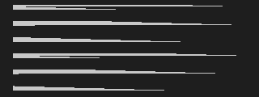
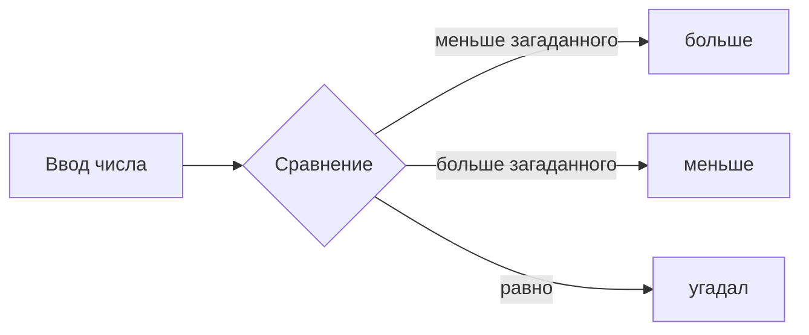

# Угадай число

 

Игра в терминале: она загадывает число, вы угадываете, а она подсказывает — больше или меньше. Тексты и режимы — в [docs/game.json](docs/game.json), их можно менять без кода.

> [!WARNING]
> Нужен Node.js 24.12 или новее.

## Как запустить

```bash
npm install
npm start
npm test
```

`npm install` — один раз, `npm start` — собрать и сыграть, `npm test` — проверить тексты и логику. Выход из игры — Ctrl+C.



## Режимы

| Режим | Диапазон | Подсказки | Победа |
|---|---|---|---|
| quick | 1–10 | мимо, больше / мимо, меньше | молния! |
| classic | 1–100 | выше бери! / ниже бери! | угадал! |

## Как идёт партия



## Что сломалось и как починил

- **Пропали два коммита.** Вместо `git reset --hard HEAD~1` набрал `HEAD~2` — ушли и тема, и новые подсказки. Нашёл их в `git reflog` и вернул `git reset --hard HEAD@{1}`.
- **Конфликт приветствия.** В ветке `greeting` и в `main` поменяли одну строку. Первый раз запутался в маркерах и отменил слияние `git merge --abort`, на свежую голову собрал строку из обеих версий в окне IntelliJ IDEA и проверил `npm test`.
